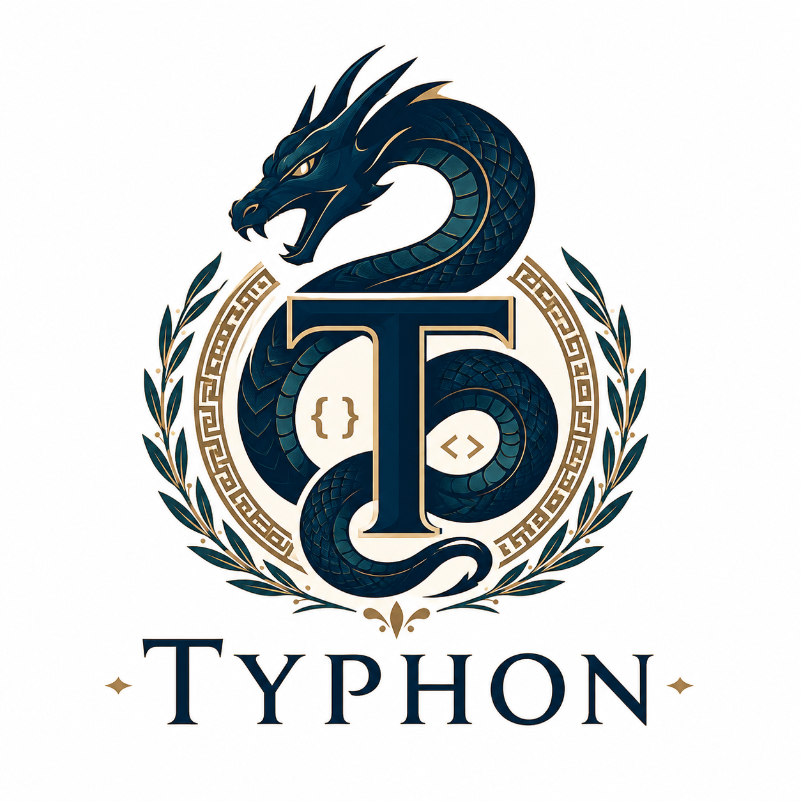

<p align="center">
  
</p>

# Typhon

Typhon is an experimental Python-like language with mandatory type annotations.
The current branch contains a parser, static checker, bytecode compiler, and
virtual machine written in Go. It also contains an optional bridge for calling
Python libraries from Typhon programs.

Typhon is currently a focused language prototype, not a complete Python
implementation. The supported syntax is the subset implemented by the Go parser
and VM and demonstrated in `examples/`.

## Execution model

The primary runtime does not translate Typhon into Go source or Python source.
The native path is:

```text
.ty source
    -> Go parser (Typhon AST)
    -> Go static checker
    -> Go bytecode compiler
    -> Typhon bytecode executed by the Go VM
```

When the native Go CLI is used directly, CPython is not involved in ordinary
Typhon execution. The Go engine starts it only when a program uses a Python
import that is not implemented by a native Go shim. The optional Python launcher
and legacy transpiler naturally start Python themselves.

## Implemented language subset

The Go runtime currently supports:

- Mandatory annotations on function parameters, return values, first variable
  declarations, class fields, and `for` targets.
- `int`, `float`, `str`, `bool`, `None`/`void`, `list[T]`, user classes,
  unions such as `User | None`, type aliases, `PyObject`, and `TyphonTask`.
- Functions, classes, annotated declarations, reassignment, `return`,
  `if`/`elif`/`else`, `while`, typed `for`, `break`, `continue`, imports,
  calls, attribute access, and f-strings.
- Checked int64 and finite floating-point arithmetic: `+`, `-`, `*`, `/`,
  `//`, `%`, unary signs, numeric/string comparisons, equality, identity,
  and short-circuit `and`, `or`, `not`.
- `print`, `range`, `enumerate`, `list.append`, and the string methods
  `strip`, `title`, and `upper`.
- Local `.ty` modules through `from module import name`.

Syntax outside that subset may be valid Python but is not necessarily valid
Typhon. In particular, the native AST currently has no general implementation
for exceptions, comprehensions, dictionaries, sets, indexing, closures,
decorators, or arbitrary Python operators.

The audit changes, precise contracts, limits, and remaining roadmap are recorded
in [VM contracts and audit status](docs/vm_contract.md).

### Type rules

```typhon
type UserId = int


class User:
    id: UserId
    name: str
    email: str | None

    def __init__(self, id: UserId, name: str, email: str | None) -> None:
        self.id = id
        self.name = name
        self.email = email


def normalize_name(name: str) -> str:
    cleaned: str = name.strip()
    return cleaned.title()


def find_user(users: list[User], id: UserId) -> User | None:
    for user: User in users:
        if user.id == id:
            return user
    return None
```

Declarations require types; later assignments to an already declared name do
not repeat the annotation:

```typhon
count: int = 0
count = count + 1
```

These declarations are rejected:

```typhon
count = 0       # first declaration has no type
items: list = [] # list element type is missing
```

Methods may leave the first `self` or `cls` parameter unannotated. All other
parameters and every function return must be annotated. `void` and `None` are
equivalent return annotations in the native checker.

Functions whose return type excludes `None` must return on every analyzed path.
Locals must be initialized before reading, and constructors must initialize all
declared fields. Literal aliases preserve their permitted values. Mutable
`list[T]` is invariant; list literals are checked element by element against
their expected type. `Any` and `PyObject` remain deliberate dynamic escapes,
with runtime checks at concrete assignments, arguments, returns, fields, and
typed loop targets. Integer-to-float promotion may round to float64 precision;
integer transport itself never uses float64.

See `examples/user_service.ty` for a complete program and
`examples/invalid_missing_types.ty` for rejected declarations.

## Requirements

- Go 1.26 or newer for the native CLI and VM.
- Python 3.11 or newer only for Python-library bridging, the Python launcher,
  and the legacy transpiler.
- Any third-party Python package used through the bridge must be installed in
  the selected Python interpreter.

## Build and run

For packaged Windows/Linux executables, included examples, integrity checks,
and source-build commands, see [distribution instructions](docs/distribution.md).

Building once avoids the extra Go tool invocation incurred by `go run`:

```powershell
go build -o typhon.exe ./cmd/typhon
.\typhon.exe version
```

Run a program:

```powershell
.\typhon.exe run examples\user_service.ty
```

The `run` command may be omitted:

```powershell
.\typhon.exe examples\user_service.ty
```

Check and compile a file without executing it:

```powershell
.\typhon.exe check examples\user_service.ty
```

Print the bytecode produced by the native compiler:

```powershell
.\typhon.exe bytecode examples\void_return.ty
```

For development, the same commands can be run without first building a binary:

```powershell
go run ./cmd/typhon run examples\user_service.ty
.\run_typhon.ps1 examples\user_service.ty
```

At execution time the main module receives `__name__ == "__main__"` and an
absolute `__file__`. Imported `.ty` modules receive their file-derived module
name. A statement such as `from local_helper import format_message` resolves
`local_helper.ty` or `local_helper/__init__.ty` relative to the importing `.ty`
file.

## Python launcher and legacy transpiler

The Python package provides a `typhon` launcher:

```powershell
python -m pip install -e .
typhon run examples\user_service.ty
```

For `run`, `check`, and `bytecode`, this launcher delegates to `typhon.exe` in
the repository root when present; otherwise it invokes `go run ./cmd/typhon`.
It is a launcher for the Go engine, not a separate Python runtime.

The older `.ty`-to-Python lowering remains available for inspection:

```powershell
typhon transpile examples\user_service.ty
```

That command validates the file and prints generated Python containing runtime
type-enforcement decorators. The lowering is implemented locally with Python's
`ast` module in `typhon/transpiler.py`; it is a legacy/debug backend and does not
define the behavior of the Go VM. The optional `transpyle` dependency is not on
the native execution path.

## Imports

Typhon currently has four import paths:

1. Local Typhon modules are loaded from `.ty` files by `from ... import ...`.
2. `json` is intercepted by the Go VM and served by a small native shim.
3. `typhon.http`, `typhon.postgres`, and `typhon.redis` are typed native Go modules.
4. Other Python modules are loaded through the Python bridge.

The native drivers provide an HTTP client/server, PostgreSQL parameterized
queries and transactions, and Redis commands with TTL. They run without Python.
See [native driver APIs and examples](docs/native_drivers.md) and
`examples/http_server.ty`, `examples/http_client.ty`, `examples/postgres.ty`,
and `examples/redis.ty`.

Use the `py.` prefix to make Python intent explicit:

```typhon
from py.math import gcd

result: int = gcd(12, 8)
print(result)
```

The prefix is removed before Python calls `importlib.import_module`. Plain
imports also work for Python packages:

```typhon
import requests as req

response: PyObject = req.get("https://example.com", timeout=10)
print(response.status_code)
```

For `from name import value`, Typhon first attempts a local `.ty` module and
falls back to Python if no matching Typhon module can be resolved. Python modules
must be importable by the selected interpreter through its normal import path.

### Native `json` shim

Both `json` and `py.json` currently resolve to a Go implementation rather than
starting CPython. The shim implements `json.dumps` with one positional argument
and supports `None`, booleans, integers, finite floats, strings, and nested lists,
with a depth limit of 64. Cycles and non-finite numbers raise errors.
It is not a complete replacement for Python's `json`
module.

## Python bridge

For a non-native Python import, Typhon starts or connects to a CPython worker.
The Go VM and worker exchange versioned, sequence-numbered JSON messages for
module import, attribute lookup, function call, health checking, and handle release.

```text
Typhon Go VM
    -> serialize request
    -> stdin/stdout pipes or authenticated loopback TCP
    -> CPython worker executes the operation
    -> serialize response
    -> convert the result to a Typhon value
```

The default is one private worker per Typhon execution. It starts lazily at the
first bridged Python import and closes with that Typhon process.

### Value conversion

| Boundary value | Conversion |
|---|---|
| `None`, `bool`, `int`, `float`, `str` | Converted directly in both directions |
| Typhon `list` | Converted recursively to a Python `list` |
| Python `list` or tuple | Converted recursively to a Typhon `list` |
| Typhon `PyObject` | Resolved to the existing object in the same bridge session |
| Other Python object | Kept in CPython and returned as a `PyObject` handle |

Python tuples are returned as Typhon lists. Modules, dictionaries, sets, class
instances, functions, and other non-primitive Python values remain in CPython;
Typhon stores a session-local object ID and Python `repr`. Attribute access and
calls on that handle are sent back to the worker. Typhon values outside the
explicit primitive/list/`PyObject` conversions fail with a conversion error;
functions are not silently converted into strings.

Python imports and their attributes have the static type `PyObject`. The current
checker therefore does not validate Python function signatures or result types;
those errors are detected only when Python executes the operation.

Protocol 2 preserves the full signed int64 range. Out-of-range Python integers
and non-finite floats are rejected. Library stdout, including writes to file
descriptor 1, is redirected to stderr in the private worker, separate from RPC.
Requests and responses are limited to 16 MiB; conversion depth is limited to 64.
`TYPHON_PYTHON_TIMEOUT` accepts a Go duration, such as `5s` (default `30s`). A
timeout closes that session; a private worker is forcibly terminated if needed.
Shared-daemon session closure does not interrupt Python code already running in
the shared interpreter. Python errors retain their type and traceback.

Unreachable handles are queued by Go finalizers and released on the next bridge
operation. For deterministic cleanup:

```typhon
from typhon.python import release
import py.math as math
release(math)
```

Reusing a released or foreign-session handle raises an error. Sessions cap live
handles at 10,000; closing a session releases its handle table after any active
Python operation finishes.

Select the bridge interpreter with `TYPHON_PYTHON`. Without it, Typhon tries the
repository `.venv`, then `python`, then `python3`.

### Warm private worker

`--warm-python` starts the worker asynchronously while the Go engine parses,
checks, and compiles the Typhon module:

```powershell
.\typhon.exe run --warm-python examples\python_bridge.ty
```

The equivalent environment setting is `TYPHON_WARM_PYTHON=1`. Warming can only
hide startup work that overlaps native compilation; it does not remove CPython
startup, imports, IPC, or value conversion.

### Shared Python daemon

`--shared-python` enables reuse of one CPython interpreter across separate
Typhon executions:

```powershell
.\typhon.exe run --shared-python examples\python_bridge.ty
```

The equivalent environment setting is `TYPHON_SHARED_PYTHON=1`. The daemon:

- Listens on a random loopback TCP port and authenticates clients with a token.
- Uses a separate object-handle table for every client connection, so handles
  cannot be reused by a later Typhon process.
- Reuses CPython itself, its import cache, and therefore imported module-level
  state across executions.
- Serializes Python operations across connected clients.
- Exits after five idle minutes by default.
- Replaces stale state when a later client cannot connect.

Set `TYPHON_PYBRIDGE_IDLE_SECONDS` to a positive number of seconds to change the
idle timeout. `TYPHON_PYBRIDGE_STATE_DIR` changes where the authenticated daemon
state and startup lock are stored.

Use the default private worker when each execution requires fresh Python module
state. If a shared daemon dies during an active execution, that execution fails;
its session-local Python objects cannot be reconstructed in another process.

### Performance model

Typhon's Python integration performs best when calls are coarse-grained. Each
Typhon/Python boundary crossing adds serialization, IPC, dispatch, and result
conversion. Keeping one Typhon process alive reuses its private worker; shared
daemon mode additionally amortizes interpreter startup across separate runs.

Thousands of small Python calls inside a Typhon loop are unfavorable. Prefer one
Python call that processes the complete dataset. Python-heavy workloads will
generally remain faster in direct Python under the current bridge architecture,
while Typhon performs best when most execution remains in the Go VM.

**Batch across the boundary; iterate on one side of it.**

## Parallel tasks

`typhon.parallel` exposes `spawn`, `join`, `cancel`, and `TyphonTask`:

```typhon
from typhon.parallel import TyphonTask, join, spawn


def double(value: int) -> int:
    return value * 2


task: TyphonTask = spawn(double, 21)
result: int = join(task)
print(result)
```

`spawn` schedules the callable in a Go goroutine. One Engine serializes VM
execution, including mutations of lists, objects, globals, and module state.
`join` yields execution to pending children and returns a cached completion;
repeated joins return the same result or error. `join(task, seconds)` sets its
wait timeout (default 30 seconds); expiration cancels the Engine execution.
`cancel(task)` requests cooperative cancellation. Main-module completion waits
for children and propagates unobserved child failures. CPU work within one
Engine is serialized under this scheduling contract.

## Benchmarks

The benchmark scripts build a native Typhon executable before timing it, so their
results do not include repeated `go run` compilation. They measure whole CLI
processes and therefore include language/runtime startup.

```powershell
.\.venv\Scripts\python.exe benchmarks\visual_benchmark.py --runs 7 --warmups 1
.\.venv\Scripts\python.exe benchmarks\resource_benchmark.py --runs 5 --warmups 1 --poll-ms 0.1 --include-warm-bridge
.\.venv\Scripts\python.exe benchmarks\bridge_warm_benchmark.py --runs 7 --warmups 1
```

The recorded results in `benchmarks/results/` show two distinct profiles:
native Typhon examples avoid CPython startup, while bridged examples pay for both
the Go VM and CPython plus IPC. Treat the checked-in numbers as measurements of
that environment, not universal performance guarantees.

The `.pyc` experiment can be rerun with:

```powershell
.\.venv\Scripts\python.exe benchmarks\precompile_python_libs.py requests urllib3 certifi charset_normalizer idna --runs 7 --warmups 1 --clean-first
```

Precompiled Python bytecode can reduce Python parsing work, but it does not remove
interpreter startup, import execution, bridge IPC, or value conversion. The
checked-in experiment did not show an improvement for the tested `requests`
dependency set.

## Tests

Run the native Go tests:

```powershell
go test ./...
```

Run the legacy Python backend tests:

```powershell
python -m unittest discover -s tests
```

## Project layout

- `cmd/typhon/`: native CLI.
- `internal/typhon/`: Go parser, checker, bytecode compiler, VM, native helpers,
  and Python bridge.
- `typhon/`: Python launcher and legacy transpiler/runtime.
- `examples/`: accepted programs and intentional error cases.
- `benchmarks/`: benchmark cases, scripts, and recorded results.
- `tests/`: legacy Python backend tests.

## License

MIT. See `LICENSE`.
